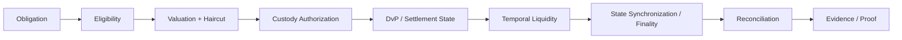

# institutional-digital-collateral-stack

[](https://github.com/vishnugovind10/institutional-digital-collateral-stack/actions/workflows/ci.yml)
[](LICENSE)


**Institutional Settlement Control Plane.** This repository is an executable reference architecture for automating institutional settlement across eligibility, valuation, custody authorization, DvP, temporal liquidity, state synchronization, reconciliation, and deterministic evidence.

The project explores how institutional settlement infrastructure changes as markets move from T+N to T+1, T+0, intraday, and continuous settlement. It uses synthetic deterministic data only. It does not implement a bank system, PwC system, custody platform, regulated settlement venue, audit product, or production financial integration.

## Problem

Tokenizing collateral is necessary but insufficient. As collateral and settlement workflows become more mobile, the binding risks shift from a single end-of-day settlement event to continuous coordination:

- Is the obligation eligible for this asset pool?
- Is the collateral value sufficient after haircut?
- Is custody authorization fresh and non-conflicting?
- Can asset and cash legs settle together?
- Does liquidity exist at the exact time obligations synchronize?
- Do operational ledgers agree after settlement?
- What evidence can be produced without assuming global visibility?

## Architecture



The control plane is intentionally thin. It composes the existing deterministic scenario runner, state machine, liquidity model, reconciliation check, evidence generator, and verifier. It does not introduce a monolithic orchestration class or external dependencies.

## Why settlement compression matters

Compressing settlement time does not eliminate operational risk; it changes where the binding constraints occur. A 30-day workflow can hide manual reconciliation and evidence collection. A T+0 or continuous workflow makes liquidity timing, authorization validity, state agreement, and evidence completeness first-class settlement infrastructure.

The settlement-compression experiment models that transition using synthetic assumptions:

```bash
python -m digital_collateral.experiments.compression
```

## What is implemented

| Surface | Implemented | Boundary |
|---|---|---|
| Control plane | Obligation execution and aggregate summary | Reference orchestration only |
| Eligibility | Deterministic policy checks | No production market data |
| Valuation | Haircut and eligible value | No external pricing |
| Custody | Authorization status and freshness | No HSM, MPC, or key control |
| Settlement | Explicit DvP state transitions | No legal finality engine |
| Liquidity | Temporal concentration and peak demand | No market-wide liquidity simulation |
| Reconciliation | Ledger-state agreement check | No enterprise recon platform |
| Evidence | Hash-bound JSON and verifier | No audit opinion |
| Exceptions | Structured exception taxonomy | No live workflow routing |

## Securitisation scenario

The repository includes a generic synthetic securitisation settlement workflow:

```text
Originator -> Asset Pool -> Eligibility -> Valuation -> SPV / Issuer
  -> Collateral Authorization -> Cash Leg -> DvP Settlement
  -> Reconciliation -> Evidence
```

Run it:

```bash
python -m digital_collateral.demo --scenario securitisation-settlement
python -m digital_collateral.demo --scenario securitisation-settlement-failure
```

This is independently designed synthetic infrastructure research. It does not reproduce, implement, validate, or claim access to any proprietary PwC or bank implementation.

## Failure scenarios

| Scenario | Command | Expected outcome |
|---|---|---|
| Successful 24/7 collateral settlement | `python -m digital_collateral.demo` | `EVIDENCE_VERIFIED` |
| Temporal liquidity failure | `python -m digital_collateral.demo --scenario temporal-liquidity-failure` | `EXCEPTION` |
| Staggered liquidity success | `python -m digital_collateral.demo --scenario staggered-success` | `EVIDENCE_VERIFIED` |
| Cash-leg failure | `python -m digital_collateral.demo --scenario cash-leg-failure` | `EXCEPTION` |
| Restricted collateral | `python -m digital_collateral.demo --scenario restricted-collateral` | `EXCEPTION` |
| Reconciliation divergence | `python -m digital_collateral.demo --scenario reconciliation-divergence` | `EXCEPTION` |
| Evidence incompleteness | `python -m digital_collateral.demo --scenario evidence-incomplete` | `ABSTAINED` |
| Securitisation success | `python -m digital_collateral.demo --scenario securitisation-settlement` | `EVIDENCE_VERIFIED` |
| Securitisation liquidity failure | `python -m digital_collateral.demo --scenario securitisation-settlement-failure` | `EXCEPTION` |
| Securitisation ineligible collateral | `python -m digital_collateral.demo --scenario securitisation-ineligible` | `EXCEPTION` |
| Securitisation cash failure | `python -m digital_collateral.demo --scenario securitisation-cash-failure` | `EXCEPTION` |
| Securitisation authorization failure | `python -m digital_collateral.demo --scenario securitisation-authorization-failure` | `EXCEPTION` |
| Securitisation reconciliation divergence | `python -m digital_collateral.demo --scenario securitisation-reconciliation-divergence` | `EXCEPTION` |

## Quickstart

```bash
git clone https://github.com/vishnugovind10/institutional-digital-collateral-stack.git
cd institutional-digital-collateral-stack
python -m pip install -e ".[dev]"
python -m pytest
python -m digital_collateral.demo
```

Control-plane summary:

```bash
python -m digital_collateral.demo --control-plane-summary
```

Compression experiment:

```bash
python -m digital_collateral.experiments.compression
```

## Control-plane summary output

The summary is computed from deterministic scenario results:

```text
INSTITUTIONAL SETTLEMENT CONTROL PLANE
--------------------------------------

Obligations                 6
Settlement Ready            3
Settling                    0
Exceptions                  2

Collateral Value        175,000,000
Eligible Value          166,500,000
Liquidity Available     127,000,000
Peak Liquidity Demand   66,800,000

Settlement Success      50.0%
Evidence Verified       50.0%
Reconciliation Divergence 16.7%

Control Plane Status:
DEGRADED
```

## Exception control model

Failures are structured by category and code:

| Category | Codes |
|---|---|
| Asset | `INELIGIBLE`, `INSUFFICIENT_VALUE`, `RESTRICTED` |
| Custody | `AUTHORIZATION_EXPIRED`, `AUTHORIZATION_CONFLICT` |
| Liquidity | `INSUFFICIENT_LIQUIDITY`, `TEMPORAL_CONCENTRATION` |
| State | `LEDGER_DIVERGENCE`, `STALE_OBSERVER` |
| Settlement | `DVP_FAILURE`, `FINALITY_FAILURE` |
| Evidence | `EVIDENCE_INCOMPLETE`, `EVIDENCE_TAMPERED`, `OBSERVATION_HORIZON_EXCEEDED` |

Each exception carries the failed control point, reason, recoverability, escalation requirement, and evidence availability.

## Benchmark

| Control | Traditional workflow | Automated control plane |
|---|---|---|
| Eligibility | Manual or batch review | Event-driven policy check |
| Valuation | Periodic valuation cycle | Deterministic haircut function |
| Authorization | Operational workflow | Policy-controlled authorization state |
| Liquidity | Periodic funding planning | Temporal peak-demand evaluation |
| Settlement | Batch instruction lifecycle | State-machine driven DvP path |
| Reconciliation | Post-event comparison | Event-driven ledger-state comparison |
| Evidence | Manual compilation | Machine-generated evidence artifact |

The table is a conceptual benchmark. It is not a production performance claim.

## Research motivation

Public industry material describes rising pressure toward settlement automation, T+1 readiness, and more continuous digital-asset infrastructure. The PwC Germany press announcement on automated settlement in securitisations is used as external context only: https://www.pwc.de/de/pressemitteilungen/2026/von-30-tagen-auf-einen-tag-pwc-stellt-neue-loesung-fuer-automatisiertes-settlement-in-verbriefungen-vor.html

This repository does not implement PwC's system, replicate proprietary technology, imply PwC validation, or claim access to PwC systems.

## Related implementations

- [tokenize-stack](https://github.com/vishnugovind10/tokenize-stack)
- [temporal-liquidity-risk](https://github.com/vishnugovind10/temporal-liquidity-risk)
- [institutional-settlement-state-machine](https://github.com/vishnugovind10/institutional-settlement-state-machine)
- [canton-proofpack](https://github.com/vishnugovind10/canton-proofpack)
- [canton-sync-debt-observatory](https://github.com/vishnugovind10/canton-sync-debt-observatory)
- [haircut](https://github.com/vishnugovind10/haircut)
- [arc-fintech-risk-layer](https://github.com/vishnugovind10/arc-fintech-risk-layer)
- [liquid-proofpack](https://github.com/vishnugovind10/liquid-proofpack)
- [liquid-witness](https://github.com/vishnugovind10/liquid-witness)
- [correlation-governor](https://github.com/vishnugovind10/correlation-governor)

## Documentation

- [Settlement control plane](docs/settlement-control-plane.md)
- [Settlement compression](docs/settlement-compression.md)
- [Securitisation settlement](docs/securitisation-settlement.md)
- [T+0 architecture](docs/t0-architecture.md)
- [Threat model](docs/threat-model.md)
- [Limitations](LIMITATIONS.md)

## Limitations

This is a deterministic reference implementation. It does not move real collateral, integrate with banks, establish legal finality, provide custody guarantees, issue an audit opinion, provide investment advice, or certify regulatory compliance.

## Contributing

See [CONTRIBUTING.md](CONTRIBUTING.md). New components must explain which institutional constraint they solve.

## Security

See [SECURITY.md](SECURITY.md). Do not use this repository with real credentials, funds, custody systems, or production financial infrastructure.

## Citation

See [CITATION.cff](CITATION.cff).

## License

Apache-2.0. See [LICENSE](LICENSE).
