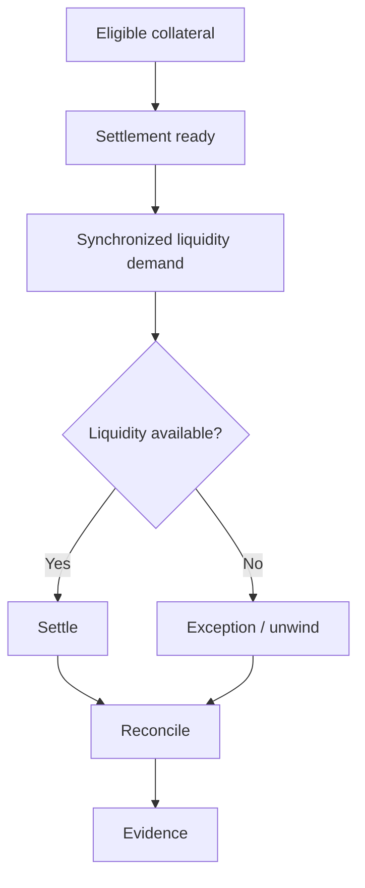

# institutional-digital-collateral-stack

[](https://github.com/vishnugovind10/institutional-digital-collateral-stack/actions/workflows/ci.yml)
[](LICENSE)


Institutional collateral infrastructure was built around settlement windows, operating hours, and fragmented system state. Tokenization can make collateral continuously mobile, but continuous mobility changes the failure surface: eligibility, custody authorization, DvP, liquidity timing, synchronization, reconciliation, and evidence become tightly coupled.

This repository is a reference architecture and executable research implementation for studying that stack. It is not a bank system, custody system, trading system, regulated settlement venue, or audit product.

## Problem

Tokenizing collateral is necessary but insufficient. Once collateral can move continuously, the infrastructure must answer several questions at the same time:

- Is the asset eligible for this obligation?
- What is it worth after valuation and haircut?
- Is custody authorization current and valid?
- Can the asset leg and cash leg settle together?
- Does liquidity exist at the exact moment obligations synchronize?
- Do relevant operational systems agree on the result?
- What evidence can be produced without assuming global ledger visibility?

The repository makes those control surfaces executable with deterministic synthetic scenarios.

## Why this matters

Faster settlement does not remove operational risk. It can move the binding constraint from aggregate balance-sheet capacity to timing, state agreement, and evidence quality. The core demonstration here is:

```text
same collateral
same total obligations
different timing
=> different settlement outcomes
```

## Architecture diagram


Failure path:



## What this demonstrates

| Surface | Demonstrates | Does not demonstrate |
|---|---|---|
| Collateral | Deterministic eligibility and valuation | Production market data |
| Custody | Policy-gated authorization | HSM or MPC production deployment |
| Settlement | Explicit DvP state transitions | Legal settlement finality |
| Liquidity | Temporal concentration model | Full market liquidity simulation |
| Reconciliation | Multi-state comparison | Enterprise reconciliation platform |
| Evidence | Structured evidence artifact and hash integrity | Independent audit opinion |
| Privacy | Bounded observer model | Real Canton production deployment |

## What this does not demonstrate

This repository does not move real money, control real collateral, connect to bank systems, provide investment advice, produce an audit opinion, certify regulatory compliance, or prove legal finality. All values are synthetic and deterministic.

## Canonical scenario

The default scenario is `24/7 Margin Collateral Mobilization`:

1. A margin call arrives outside local banking hours.
2. The stack identifies eligible tokenized treasury collateral.
3. The valuation engine applies a haircut.
4. Custody policy authorizes mobilization.
5. The settlement state machine creates a DvP path.
6. Liquidity demand is calculated.
7. The temporal-liquidity engine evaluates timing concentration.
8. Settlement succeeds or enters `EXCEPTION`.
9. Reconciliation checks asset ledger, settlement ledger, and custody intent.
10. Evidence is generated.
11. The verifier checks hash integrity and false-verification boundaries.

## Failure scenarios

| Scenario | Command | Expected outcome |
|---|---|---|
| Successful 24/7 settlement | `python -m digital_collateral.demo` | `EVIDENCE_VERIFIED` |
| Temporal liquidity failure | `python -m digital_collateral.demo --scenario temporal-liquidity-failure` | `EXCEPTION` |
| Staggered liquidity success | `python -m digital_collateral.demo --scenario staggered-success` | `EVIDENCE_VERIFIED` |
| Cash-leg failure | `python -m digital_collateral.demo --scenario cash-leg-failure` | `EXCEPTION` |
| Restricted collateral | `python -m digital_collateral.demo --scenario restricted-collateral` | `EXCEPTION` |
| Reconciliation divergence | `python -m digital_collateral.demo --scenario reconciliation-divergence` | `EXCEPTION` |
| Evidence incompleteness | `python -m digital_collateral.demo --scenario evidence-incomplete` | `ABSTAINED` |

## Component map

| Layer | Local component | Source reference | Role | Status |
|---|---|---|---|---|
| Asset | `CollateralAsset` | `tokenize-stack` | Tokenized/restricted asset representation | Implemented locally |
| Valuation | `Valuation` and eligible value | `haircut` | Eligible collateral value | Adapted concept |
| Custody | `CustodyAuthorization` | `tokenize-stack` | Mobilization permission | Implemented locally |
| Settlement | `SettlementStateMachine` | `institutional-settlement-state-machine` | Lifecycle and DvP conditions | Adapted concept |
| Liquidity | `LiquidityProfile` | `temporal-liquidity-risk` | Time-concentrated liquidity stress | Implemented locally |
| Synchronization | `ObserverScope` | `canton-sync-debt-observatory` | Cross-partition state agreement | Conceptual mapping |
| Evidence | Evidence artifact and verifier | `canton-proofpack` | Structured substantiation | Implemented locally |
| Evidence extension | Evidence status vocabulary | `liquid-proofpack` | Scoped attestation model | Referenced |
| Treasury context | Liquidity/cash surface | `arc-fintech-risk-layer` | Optional cash-context reference | Referenced |

## Implementation status

| Component | Status | Evidence |
|---|---|---|
| Scenario orchestration | Implemented | `tests/test_core.py` |
| Eligibility and valuation | Implemented | Unit tests |
| Custody authorization boundary | Implemented | Scenario tests |
| Settlement transition invariants | Implemented | Invalid transition tests |
| Temporal liquidity model | Implemented | Synchronized vs staggered tests |
| Reconciliation divergence | Implemented | Divergence scenario |
| Evidence generation and verification | Implemented | Tamper test |
| External ledger adapters | Deferred | Explicit non-goal |
| Production custody, bank, and market data integrations | Deferred | Explicit non-goal |

## Quickstart

```bash
git clone https://github.com/vishnugovind10/institutional-digital-collateral-stack.git
cd institutional-digital-collateral-stack
python -m pip install -e ".[dev]"
python -m pytest
python -m digital_collateral.demo
```

Run specific scenarios:

```bash
python -m digital_collateral.demo --scenario temporal-liquidity-failure
python -m digital_collateral.demo --scenario staggered-success
python -m digital_collateral.demo --scenario evidence-incomplete --json
```

## Demo output

Expected default shape:

```text
INSTITUTIONAL DIGITAL COLLATERAL STACK
--------------------------------------

Collateral:
  status: ELIGIBLE
  gross value: 10,000,000
  haircut: 2.0%
  eligible value: 9,800,000

Liquidity:
  required aggregate: 8,400,000
  peak demand: 4,200,000
  available: 9,000,000
  temporal concentration: MODERATE

Outcome:
  EVIDENCE_VERIFIED
```

## Risk / liquidity model

The liquidity model keeps the `temporal-liquidity-risk` insight visible:

```text
required_liquidity = obligation_amount * reuse_depth * shock
```

Aggregate required liquidity is not the same as peak demand. The system compares available liquidity to the peak interval demand.

| Case | Collateral | Obligations | Available liquidity | Timing | Peak demand | Outcome |
|---|---:|---:|---:|---|---:|---|
| Staggered | 10,000,000 | 8,000,000 | 8,000,000 | Two intervals | 4,200,000 | Success |
| Synchronized | 10,000,000 | 8,000,000 | 8,000,000 | One interval | 8,400,000 | Failure |

## Settlement state model

| Current State | Event | Condition | Next State |
|---|---|---|---|
| `TRADE_CONFIRMED` | compliance-check | approved | `COMPLIANCE_APPROVED` |
| `COMPLIANCE_APPROVED` | eligibility-check | eligible | `COLLATERAL_ELIGIBLE` |
| `COLLATERAL_ELIGIBLE` | asset-check | available | `ASSET_AVAILABLE` |
| `ASSET_AVAILABLE` | cash-check | available | `CASH_AVAILABLE` |
| `CASH_AVAILABLE` | authorize | policy passes | `CUSTODY_AUTHORIZED` |
| `CUSTODY_AUTHORIZED` | liquidity-check | sufficient | `SETTLEMENT_READY` |
| `SETTLEMENT_READY` | execute | DvP passes | `SETTLING` |
| `SETTLING` | finality | final | `SETTLED` |
| `SETTLED` | reconcile | matched | `RECONCILIATION_PENDING` |
| `RECONCILIATION_PENDING` | reconcile | matched | `RECONCILED` |
| `RECONCILED` | evidence-check | complete | `EVIDENCE_VERIFIED` |
| `SETTLEMENT_READY` | liquidity-failure | insufficient | `EXCEPTION` |
| `RECONCILED` | evidence-check | incomplete | `ABSTAINED` |

Operational completion, economic finality, reconciliation, and evidence are distinct dimensions.

## Evidence model

Evidence is machine-readable and hash-bound:

```json
{
  "schema_version": "0.1",
  "transaction_id": "COLL-2026-0001",
  "collateral": {
    "asset_id": "UST-2026-A",
    "gross_value": 10000000,
    "haircut": 0.02,
    "eligible_value": 9800000,
    "status": "ELIGIBLE"
  },
  "liquidity": {
    "required": 8400000,
    "peak_demand": 4200000,
    "available": 9000000,
    "status": "SUFFICIENT"
  },
  "evidence": {
    "status": "VERIFIED",
    "classification": "SELF_EVIDENT"
  }
}
```

The verifier never reports `VERIFIED` for trust-only, incomplete, replay-only, or beyond-horizon evidence.

## Repository composition

```text
src/digital_collateral/   reference implementation
tests/                    unit, scenario, invariant, and adversarial checks
docs/                     architecture details and threat model
examples/                 deterministic evidence outputs
scripts/                  publication validation
```

## Relationship to source repositories

This repository is not a merge of the source repositories. It is a thin integration thesis that defines common interfaces, runs deterministic scenarios, and links the source projects as deeper component references.

## Research motivation

Citi's research page, [Digital Collateral: A Practical Reality](https://www.citigroup.com/global/insights/digital-collateral-a-practical-reality), describes institutional movement toward practical digital-collateral workflows. This repository uses that public research as problem framing only. It does not imply Citi endorsement, partnership, deployment, or access to Citi systems.

## Related Implementations

- [tokenize-stack](https://github.com/vishnugovind10/tokenize-stack)
- [temporal-liquidity-risk](https://github.com/vishnugovind10/temporal-liquidity-risk)
- [institutional-settlement-state-machine](https://github.com/vishnugovind10/institutional-settlement-state-machine)
- [canton-proofpack](https://github.com/vishnugovind10/canton-proofpack)
- [canton-sync-debt-observatory](https://github.com/vishnugovind10/canton-sync-debt-observatory)
- [haircut](https://github.com/vishnugovind10/haircut)
- [arc-fintech-risk-layer](https://github.com/vishnugovind10/arc-fintech-risk-layer)
- [liquid-proofpack](https://github.com/vishnugovind10/liquid-proofpack)
- [liquid-witness](https://github.com/vishnugovind10/liquid-witness)
- [correlation-governor](https://github.com/vishnugovind10/correlation-governor)

## Limitations

See [LIMITATIONS.md](LIMITATIONS.md). The short version: synthetic data, no real collateral, no production custody, no regulated settlement, no legal-finality engine, no bank integration, no guarantee of liquidity, no investment recommendation, no audit opinion, and no regulatory advice.

## Threat model

See [docs/threat-model.md](docs/threat-model.md). The model focuses on malicious operators, stale observers, dishonest counterparties, replayed evidence, tampering, inconsistent data sources, and timing manipulation.

## Roadmap

See [ROADMAP.md](ROADMAP.md). The roadmap is scoped to reference architecture evolution, not bank integrations.

## Contributing

See [CONTRIBUTING.md](CONTRIBUTING.md). New components must explain which institutional constraint they solve.

## Security

See [SECURITY.md](SECURITY.md). Do not use this repository with real credentials, funds, custody systems, or production financial infrastructure.

## Citation

See [CITATION.cff](CITATION.cff).

## Sources

Source repositories are listed in [REFERENCES.md](REFERENCES.md) and [docs/source-repositories.md](docs/source-repositories.md). No source repository is vendored into this project.

## Author

Vishnu Govind.

## License

Apache-2.0. See [LICENSE](LICENSE).
