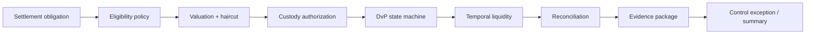

# Settlement Control Plane

The settlement control plane coordinates a settlement obligation across eligibility, valuation, custody authorization, DvP state, temporal liquidity, reconciliation, and evidence. It is a reference orchestration layer, not a production workflow engine.

## Component responsibilities

| Component | Responsibility |
|---|---|
| Obligation | Describes the synthetic settlement request being tested |
| Eligibility | Rejects ineligible collateral before settlement readiness |
| Valuation | Computes eligible value after haircut |
| Custody | Models authorization state and freshness |
| Settlement | Enforces explicit state transitions |
| Liquidity | Compares peak timed demand with available liquidity |
| Reconciliation | Compares asset ledger, settlement ledger, and custody intent |
| Evidence | Emits deterministic hash-bound proof material |
| Exception control | Explains what failed, where it failed, and whether escalation is required |

## Failure handling

Failures are not collapsed into a boolean. The result includes category, code, failed control point, reason, recoverability, escalation requirement, and evidence availability.

## Boundaries

The control plane does not connect to production custody systems, banks, market data, CSDs, blockchains, PwC systems, or auditors. It is a deterministic architecture harness for studying compressed institutional settlement.
